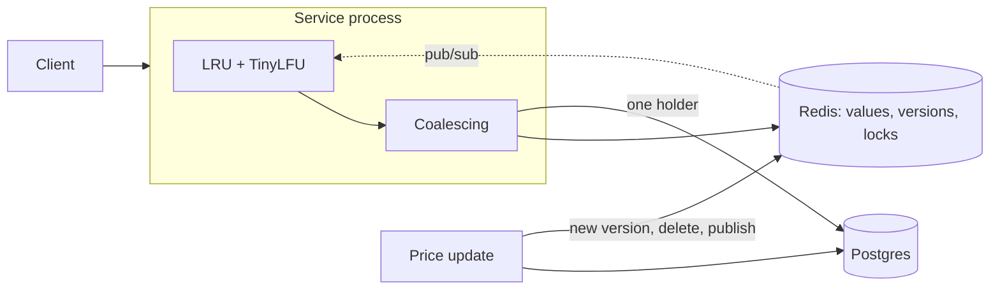

# Hotpath

A read-through cache for a slow API, built to stay correct while data changes, processes multiply and Redis fails. In-process LRU with TinyLFU admission, then Redis, then Postgres.

It's a technical demonstration, not a production service. See [Limits](docs/DESIGN.md#limits).

## The hard problem

Deleting a cached value after a write isn't enough. A reader that loaded the old value just before the write can store it just after the delete, and it stays wrong until its TTL. The same race exists in each process's memory, and in requests that share one load.

## Results

One run on a single machine, in Linux, with the load generator, service, Postgres and Redis sharing it. Use these to compare designs, not as capacity figures. Full tables: [benchmark](docs/bench-results.md), [eviction policies](docs/policy-results.md).

| Check | Result |
| --- | --- |
| Write storm, 1,200 final reads: without the version guard | 117 wrong values left behind |
| Same storm with it | 0 |
| 300 requests for one cold key, 3 processes: database loads without protection | 192–300 per round |
| Same burst with coalescing and a Redis lock | 1 per round |
| Throughput, no cache and cached | 2,450 → about 26,000 requests/s |
| p99, no cache and cached | 31.5 ms → 3.3 ms (Redis), 4.8 ms (both layers) |
| TinyLFU over LRU, hit rate | 2.9 to 7.3 points higher |

Two findings I didn't expect:

- **The in-process layer didn't make the service faster than Redis alone here** (25,981 and 26,261 requests/s). It cut Redis reads by 64%, from 21,474 to 7,824 per second. It pays off when Redis is the bottleneck or far away, and it adds an invalidation problem.
- **The lock has a price.** It takes a stampede from 3 loads to 1 but raises p50 from 11 to 20 ms, because waiters poll. With few processes and a cheap query, coalescing alone is the better choice.

## Architecture



## What's in it

| Piece | File |
| --- | --- |
| LRU on a hash map and linked list, O(1) | [src/cache/lru.ts](src/cache/lru.ts) |
| Count-min sketch and TinyLFU admission | [src/cache/tinylfu.ts](src/cache/tinylfu.ts) |
| Coalescing that forgets loads a write has overtaken | [src/cache/singleflight.ts](src/cache/singleflight.ts) |
| Version-guarded stores, locks, circuit breaker | [src/cache/redisLayer.ts](src/cache/redisLayer.ts) |
| The read path, stale-while-revalidate, invalidation | [src/cache/tieredCache.ts](src/cache/tieredCache.ts) |

[DESIGN.md](docs/DESIGN.md) covers decisions, rejected alternatives, failure modes and limits.

## Run it

Needs Node 22+ and Redis. Tests and benchmarks start their own Postgres.

```bash
npm install
docker compose up -d redis
npm test              # 31 tests, including cut and frozen Redis connections
npm run bench
npm run bench:policy  # simulation only, no Redis needed
```

To run the service itself:

```bash
docker compose up -d
cp .env.example .env
node --env-file=.env --import tsx src/server.ts
```

## API

| Endpoint | Purpose |
| --- | --- |
| `GET /products/:id` | Product detail. `x-cache` says where it came from: `l1`, `l2`, `origin`, `stale` or `coalesced`. |
| `PUT /products/:id/price` | Change a price and invalidate it everywhere. |
| `GET /metrics` | Counters and event-loop utilization. |
| `GET /healthz`, `GET /readyz` | Liveness, and database readiness. |

## What I'd do next

- W-TinyLFU, so newly popular keys are admitted sooner.
- An outbox for invalidations, to cover a crash between commit and invalidate.
- A limit on concurrent loads of different cold keys.
- Benchmarks with the load generator on a separate machine.
